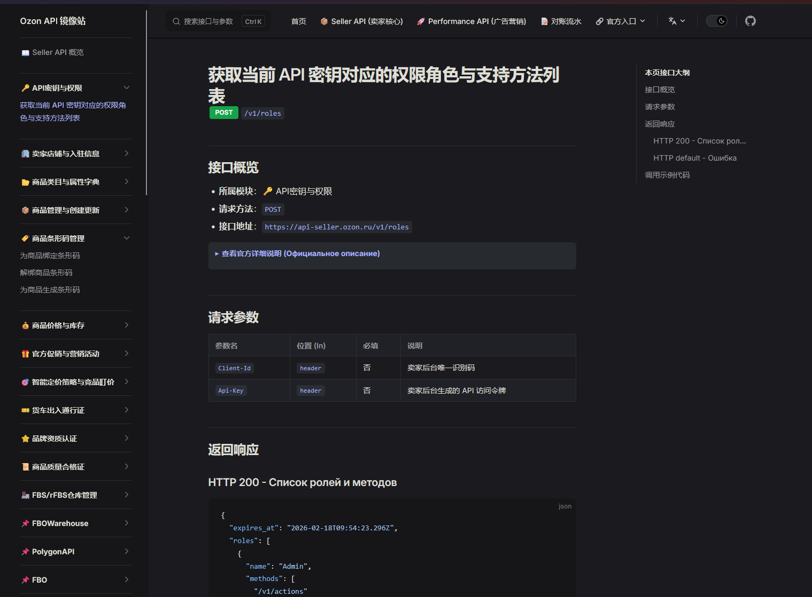

# Ozon 开发者 API 全量交互式镜像站 (OpenAPI 3.0)

[](https://ywl-ozon-track.github.io/ozon-api-doc/)
[](https://github.com/ywl-ozon-track/ozon-api-doc/actions/workflows/cron-sync-pr.yml)
[](https://nodejs.org/)
[](https://vitepress.dev/)
[](https://vuejs.org/)
[](https://www.openapis.org/)

> 🚀 **在线镜像访问入口**: [https://ywl-ozon-track.github.io/ozon-api-doc/](https://ywl-ozon-track.github.io/ozon-api-doc/)

本项目是 **Ozon 官方开发者 API 文档（Seller API & Performance API）** 的现代化纯 VitePress 原生矩阵镜像站。默认中文友好，支持中/俄/英三语无缝切换，搭载 Minisearch 离线毫秒级全文检索与每日自动化巡检对账流水线。

---

## 📸 界面预览 (UI Preview)



---

## 🌟 核心特色

1. **纯 VitePress 原生矩阵静态化 (SSG)**：
   - 告别传统 iframe 嵌套与重型外部运行时，将 530+ 个接口端点编译为轻量独立 Markdown 页面，页面进入毫秒级秒开时代；
   - 彻底根除滚动条穿透、移动端卡顿，完美适配深浅色主题自适应。

2. **默认中文适配与多语言原生切换 (ZH / RU / EN)**：
   - **默认中文 (zh-CN)**：面向跨境卖家优化，60+ 业务模块与高频操作精准本地化对齐；
   - **俄语原版 (ru-RU)**：100% 忠实保留 Ozon 官方原厂定义与说明；
   - **英语版 (en-US)**：为国际化开发者提供标准规范索引；
   - 支持顶栏下拉菜单一键跨语言无缝穿透。

3. **原生离线毫秒级全文检索 (Local Minisearch)**：
   - 集成高性能本地搜索引擎，支持接口路径（如 `/v1/roles`、`/v1/product/import-prices`）、HTTP 方法、参数名与中文/俄文字段的即打即搜。

4. **GitHub Actions 每日对账 Bot (PR 审批驱动)**：
   - 每天自动定时比对 Ozon 官方源（docs.ozon.ru），变更自动生成 PR 审查报告，保障规范变动清晰可溯。

---

## 🛠️ 本地开发与构建

```bash
# 1. 安装依赖
npm install

# 2. 启动本地开发热更新服务
npm run docs:dev

# 3. 生成全量多语言文档并执行生产打包
npm run docs:build

# 4. 本地预览产物
npm run docs:preview
```

---

## 📄 官方文档溯源

- **Ozon Seller API 官方主站**: [https://docs.ozon.ru/api/seller/](https://docs.ozon.ru/api/seller/)
- **Ozon Performance API 官方主站**: [https://docs.ozon.ru/api/performance/](https://docs.ozon.ru/api/performance/)
- **Ozon 官方 OpenAPI 规范源**:
  - `https://docs.ozon.ru/api/seller/swagger.json`
  - `https://docs.ozon.ru/api/performance/swagger.json`

---

## ⚖️ 免责声明

本项目提供的规范数据来源于 Ozon 官方公开技术文档，仅供跨国跨境电商开发者学习、接口调试与对接参考。所有商标与官方接口版权归 Ozon 官方所有。
